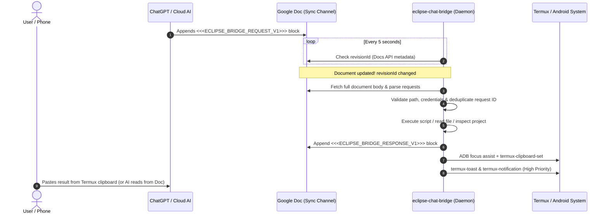

# ECLIPSE Chat Bridge (`eclipse-chat-bridge`)

[](https://opensource.org/licenses/MIT)
[](https://www.python.org/)
[]()

An automated, bidirectional bridge between **Google Docs**, **Android Termux**, and the **ECLIPSE local execution runtime**. 

It enables cloud-based LLM assistants (such as ChatGPT or Gemini in browser sessions) to safely submit local execution requests—such as project diagnostics, tests, and build checks—and receive verified execution results with real-time Android notifications and bidirectional Google Doc synchronization.

---

## 🏗 Architecture & Workflow



---

## ✨ Features

- **Google Docs Revision Polling:** Monitors document edits via Google Docs API `revisionId` field projection (`fields=revisionId`). Checks take ~2.5s on average with tiny payloads (~150 bytes), preventing API quota exhaustion.
- **Automated Hands-Free Execution:** Default `--execution auto` mode processes verified diagnostic requests immediately without blocking for local CLI prompt confirmation.
- **Android Background Clipboard Assist:** Android 10+ (`SDK >= 29`) blocks background services from reading or writing to the clipboard. The bridge features an automated ADB focus-assist fallback to toggle Termux foreground activity for 0.35s, sets the clipboard, and returns focus back to Chrome seamlessly.
- **Dual Android Notifications:** Simultaneously displays an on-screen toast (`termux-toast`) and persistent Android system notification tray alert (`termux-notification`) with high priority.
- **Bidirectional Google Doc Sync:** Automatically formats and appends response blocks (`<<<ECLIPSE_BRIDGE_RESPONSE_V1>>>`) directly back into the Google Doc, giving LLM assistants a direct return channel.
- **Idempotent & Safe Execution:**
  - Strict regex request ID verification (`^[A-Za-z0-9][A-Za-z0-9_-]{7,63}$`).
  - Request deduplication and tamper detection via SHA-256 fingerprinting in `requests.json`.
  - Path confinement within allowed project directories.
  - Hardened credential exclusion (blocks access to `token.json`, `credentials.json`, `.env`, SSH keys).
  - Subprocess timeouts and output caps (maximum 24,000 characters).

---

## 📜 Protocol Specification

### 1. Request Format (`<<<ECLIPSE_BRIDGE_REQUEST_V1>>>`)
The cloud assistant appends a request block to the designated Google Doc:

```json
<<<ECLIPSE_BRIDGE_REQUEST_V1>>>
{
  "id": "signal_browser_capabilities_20261114_r1",
  "action": "run",
  "cwd": "/root/projects/chat-run-docs",
  "script": "python3 -m unittest -v tests/test_tripo.py",
  "timeout_seconds": 60
}
<<<END_ECLIPSE_BRIDGE_REQUEST_V1>>>
```

Supported actions:
- **`run`**: Executes a bash script in `cwd` with strict process isolation and timeout.
- **`read_file`**: Reads bounded lines from a target file (`path`, `start_line`, `line_count`).
- **`list_files`**: Lists non-hidden directory contents (`path`).

### 2. Response Format (`<<<ECLIPSE_BRIDGE_RESPONSE_V1>>>`)
The bridge automatically writes the receipt to the document and to the local state directory:

```json
<<<ECLIPSE_BRIDGE_RESPONSE_V1>>>
{
  "id": "signal_browser_capabilities_20261114_r1",
  "result": {
    "status": "completed",
    "action": "run",
    "result": {
      "exit_code": 0,
      "timeout_or_output_limit": false,
      "output": "test_tripo_export (tests.test_tripo.TripoTests) ... ok\nRan 1 test in 0.042s\nOK\n",
      "truncated": false,
      "full_output_file": "/root/.local/state/eclipse-chat-bridge/results/signal_browser_capabilities_20261114_r1.raw"
    }
  }
}
<<<END_ECLIPSE_BRIDGE_RESPONSE_V1>>>
```

---

## 🚀 Quick Start

### Prerequisites
- Python 3.10+
- Termux with `termux-api` installed (`pkg install termux-api`)
- Google OAuth credentials configured in `chat-run-docs`

### Installation
```bash
git clone https://github.com/rmtaa0916/eclipse-chat-bridge.git
cd eclipse-chat-bridge
pip install -r requirements.txt
```

### CLI Management (`bin/eclipse-bridge`)

A management script is included in `bin/eclipse-bridge`:

```bash
# Start the bridge daemon in background
./bin/eclipse-bridge start

# Check running status and request statistics
./bin/eclipse-bridge status

# View live execution logs
./bin/eclipse-bridge logs -f

# Run one single polling iteration and exit
./bin/eclipse-bridge once

# Run the unit test suite
./bin/eclipse-bridge test

# Stop the daemon
./bin/eclipse-bridge stop
```

---

## ⚙️ Configuration & Environment Variables

| Variable | Description | Default |
|---|---|---|
| `ECLIPSE_DOC_ID` | Default Google Doc ID to monitor | `1N_TYeHUTexHaU2eiZ40hMWsaNNl-GaZJ-6H1MxHPPYM` |
| `ECLIPSE_CORE_DIR` | Path to core Google Docs OAuth client | `/root/projects/chat-run-docs` |
| `ECLIPSE_BRIDGE_STATE` | State directory for tracking requests & logs | `/root/.local/state/eclipse-chat-bridge` |

---

## 🧪 Testing

The test suite validates request parsing, path validation, execution sandboxing, toast/notification triggers, and revision caching:

```bash
python3 -m unittest -v test_watch.py
```

---

## 📄 License

This project is licensed under the [MIT License](LICENSE).
