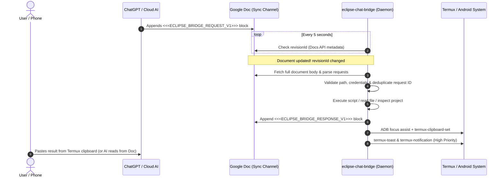

# ECLIPSE Chat Bridge (`eclipse-chat-bridge`)

[](https://opensource.org/licenses/MIT)
[](https://www.python.org/)
[]()

An automated, bidirectional bridge between **Google Docs**, **Android Termux**, and the **ECLIPSE local execution runtime**. 

It enables cloud-based LLM assistants (such as ChatGPT or Gemini in browser sessions) to safely submit local execution requests—such as project diagnostics, tests, and build checks—and receive verified execution results with real-time Android notifications and bidirectional Google Doc synchronization.

---

## 🏗 Architecture & Workflow



---

## ✨ Features

- **Google Docs Revision Polling:** Monitors document edits via Google Docs API `revisionId` field projection (`fields=revisionId`). Checks take ~2.5s on average with tiny payloads (~150 bytes), preventing API quota exhaustion.
- **Automated Hands-Free Execution:** Default `--execution auto` mode processes verified diagnostic requests immediately without blocking for local CLI prompt confirmation.
- **Android Background Clipboard Assist:** Android 10+ (`SDK >= 29`) blocks background services from reading or writing to the clipboard. The bridge features an automated ADB focus-assist fallback to toggle Termux foreground activity for 0.35s, sets the clipboard, and returns focus back to Chrome seamlessly.
- **Dual Android Notifications:** Simultaneously displays an on-screen toast (`termux-toast`) and persistent Android system notification tray alert (`termux-notification`) with high priority.
- **Bidirectional Google Doc Sync:** Automatically formats and appends response blocks (`<<<ECLIPSE_BRIDGE_RESPONSE_V1>>>`) directly back into the Google Doc, giving LLM assistants a direct return channel.
- **Idempotent & Safe Execution:**
  - Strict regex request ID verification (`^[A-Za-z0-9][A-Za-z0-9_-]{7,63}$`).
  - Request deduplication and tamper detection via SHA-256 fingerprinting in `requests.json`.
  - Path confinement within allowed project directories.
  - Hardened credential exclusion (blocks access to `token.json`, `credentials.json`, `.env`, SSH keys).
  - Subprocess timeouts and output caps (maximum 24,000 characters).

---

## 📜 Protocol Specification

### 1. Request Format (`<<<ECLIPSE_BRIDGE_REQUEST_V1>>>`)
The cloud assistant appends a request block to the designated Google Doc:

```json
<<<ECLIPSE_BRIDGE_REQUEST_V1>>>
{
  "id": "signal_browser_capabilities_20261114_r1",
  "action": "run",
  "cwd": "/root/projects/chat-run-docs",
  "script": "python3 -m unittest -v tests/test_tripo.py",
  "timeout_seconds": 60
}
<<<END_ECLIPSE_BRIDGE_REQUEST_V1>>>
```

Supported actions:
- **`run`**: Executes a bash script in `cwd` with strict process isolation and timeout.
- **`read_file`**: Reads bounded lines from a target file (`path`, `start_line`, `line_count`).
- **`list_files`**: Lists non-hidden directory contents (`path`).
- **`read_result`** (staged): Retrieve a bounded byte range from a previous completed execution result. No shell execution.
- **`find_result`** (staged): Case-insensitive ASCII literal search in saved output, returning the matching offset and evidence excerpt.

### Retrieve previous diagnostic evidence (staged actions)

Both operations accept a prior request ID, not a filesystem path. The watcher
verifies that the ID is recorded as completed, that a matching completed
`run` receipt exists, and that its output file is in the bridge's own
results directory. No symlinks or hardlinks are followed. Output is capped
and each response carries the source SHA-256 fingerprint.

Read a saved range:

```json
{
  "id": "context_read_20261115_r1",
  "action": "read_result",
  "source_id": "previous_run_20261115_r1",
  "offset": 0,
  "max_bytes": 240
}
```

Search a saved result without knowing the error's byte offset:

```json
{
  "id": "context_find_20261115_r1",
  "action": "find_result",
  "source_id": "previous_run_20261115_r1",
  "query": "Traceback",
  "start_offset": 0,
  "max_bytes": 240
}
```

The reader automatically sizes JSON output for the tablet's existing
650-character Latest Diagnostic slot. Each action still requires a unique
request ID; source_id refers to the original completed run. For pagination,
reuse the returned next_offset, and for subsequent literal matches use
next_search_offset. Byte offsets refer to the original UTF-8 output file.

These actions do not change the Google Docs protocol, run tests, or modify
the provider browser. The new code is staged on an isolated branch and is
not live until separately activated.

### 2. Response Format (`<<<ECLIPSE_BRIDGE_RESPONSE_V1>>>`)
The bridge automatically writes the receipt to the document and to the local state directory:

```json
<<<ECLIPSE_BRIDGE_RESPONSE_V1>>>
{
  "id": "signal_browser_capabilities_20261114_r1",
  "result": {
    "status": "completed",
    "action": "run",
    "result": {
      "exit_code": 0,
      "timeout_or_output_limit": false,
      "output": "test_tripo_export (tests.test_tripo.TripoTests) ... ok\nRan 1 test in 0.042s\nOK\n",
      "truncated": false,
      "full_output_file": "/root/.local/state/eclipse-chat-bridge/results/signal_browser_capabilities_20261114_r1.raw"
    }
  }
}
<<<END_ECLIPSE_BRIDGE_RESPONSE_V1>>>
```

---

## Priority-aware project and research context snapshots

The `context_snapshot` action now **ranks directory and filename metadata
before allocating source-read bytes**. Revision 11 still opens and screens
every selected file using descriptor-relative no-follow file access, file and
aggregate read limits, and best-effort sensitive-content filtering. The Mode 7
Source Router contributes pure lexical relevance scoring over already-screened
source paths. Its separate raw-filesystem scan is not used to authorize access.

Example:

```json
{
  "id": "context_priority_20261115_r1",
  "action": "context_snapshot",
  "project": "eclipse-chat-bridge",
  "goal": "diagnose bridge result delivery and source-routing dependencies"
}
```

For documentation/research questions, use a goal such as
`"review research protocol notes and summarize study evidence"`.
The selector recognizes documentation intent and reserves more of the bounded
reading budget for `.md` and `.txt` files. This is local document research,
not an internet literature search; PDF/Office files are not yet included in
Revision 11's native source allowlist.

The result JSON remains local in the bridge's private results directory;
the Google Doc only contains a compact receipt. Use `find_result` to locate
relevant symbols, paths, or findings in the saved snapshot and `read_result`
for targeted excerpts, using the original snapshot request ID as `source_id`.

Key boundaries and limitations:

- Only immediate project directories under the trusted `/root/projects`
  workspace are accepted. The request cannot supply an absolute root path.
- Source selection is capped at 40 screened files and 96 attempted opens,
  with Revision 11's file and aggregate-byte limits and directory budgets.
- Backup, build, vendor, node_modules and archive paths are excluded from
  primary source evidence. Symlinks/hardlinks and flagged secret-containing
  file contents are denied.
- Context completeness is never assumed. Snapshot `reader.truncated`,
  `reader.eligible_candidates`, `reader.source_attempts`, and `gaps`
  describe selection limits. The inferred graph is not proof of runtime behavior.
- Context Capture remains `NOT_ATTACHED`, no provider prompts are submitted,
  and no browser tabs or game files are touched.

Example research queries can summarize locally saved Markdown or plain-text
notes, while fresh outside sources should be retrieved separately through
ChatGPT's web or connected research tools.

---

## 🚀 Quick Start

### Prerequisites
- Python 3.10+
- Termux with `termux-api` installed (`pkg install termux-api`)
- Google OAuth credentials configured in `chat-run-docs`

### Installation
```bash
git clone https://github.com/rmtaa0916/eclipse-chat-bridge.git
cd eclipse-chat-bridge
pip install -r requirements.txt
```

### CLI Management (`bin/eclipse-bridge`)

A management script is included in `bin/eclipse-bridge`:

```bash
# Start the bridge daemon in background
./bin/eclipse-bridge start

# Check running status and request statistics
./bin/eclipse-bridge status

# View live execution logs
./bin/eclipse-bridge logs -f

# Run one single polling iteration and exit
./bin/eclipse-bridge once

# Run the unit test suite
./bin/eclipse-bridge test

# Stop the daemon
./bin/eclipse-bridge stop
```

---

## ⚙️ Configuration & Environment Variables

| Variable | Description | Default |
|---|---|---|
| `ECLIPSE_DOC_ID` | Default Google Doc ID to monitor | `1N_TYeHUTexHaU2eiZ40hMWsaNNl-GaZJ-6H1MxHPPYM` |
| `ECLIPSE_CORE_DIR` | Path to core Google Docs OAuth client | `/root/projects/chat-run-docs` |
| `ECLIPSE_BRIDGE_STATE` | State directory for tracking requests & logs | `/root/.local/state/eclipse-chat-bridge` |

---

## 🧪 Testing

The test suite validates request parsing, path validation, execution sandboxing, toast/notification triggers, and revision caching:

```bash
python3 -m unittest -v test_watch.py
```

---

## 📄 License

This project is licensed under the [MIT License](LICENSE).
